# 王者教研室 · 王者荣耀 BP / 出装数据助手

> 给开黑用的「离线优先」王者荣耀数据工具：**BP 推测 · 离线语音输入 · 分路反制 · 针对性出装 · 五黑阵容 · 名师课堂 · 数据热更新 · AI 问答**。


[下载 APK](https://github.com/caoj47883-create/wangzhe-jiaoyanshi/releases/latest) ·
[数据仓库](https://github.com/caoj47883-create/wzjs-data) ·
[PRD](docs/PRD-王者教研室-V2.1.1.md) ·
[架构说明](docs/ONLINE_UPDATE_ARCHITECTURE.md) ·
[语音词库](docs/VOICE_LEXICON.md)

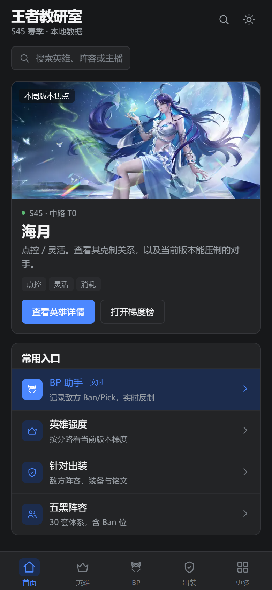

---

## 这是什么

一个私人使用的 Android App（个人项目，非官方、非商业）：

- **不需要登录**，断网也能用；
- 内置 134 位英雄、900+ 条克制关系、30 套五黑阵容、51 位 KPL 选手/主播；
- **BP 助手**：输入敌方 Ban 位 → 推测对面想玩谁 → 按分路给反制推荐 → 一键带入出装；
- **BP 离线语音输入**：按住语音条说「对面 ban 东皇太一」「选马可波罗」，端侧 sherpa-onnx 中文模型 + 本地英雄词典自动填槽，不依赖系统语音服务/网络；
- **数据热更新**：赛季中英雄/装备调整后，不重装 APK，App 自动拉取新数据；
- **AI 问答**：结合本地数据的 RAG 上下文，调用你自己的 OpenAI 兼容接口；
- 飞书式克制工作台，暗夜/纸感双主题 + 字号缩放。

> 仅用于个人学习/研究。英雄原画、名称等素材版权归腾讯《王者荣耀》所有，详见 [NOTICE.md](NOTICE.md)。

## 功能

| 模块 | 说明 |
| --- | --- |
| 首页 | 当前赛季焦点英雄、搜索、常用入口（BP 优先）、本周阵容、名师课堂、最近查看 |
| 英雄强度 | 5 分路 T0~T3 梯度、搜索、分路徽章、英雄详情弹层 |
| 英雄详情 | 克制链（能打谁/被谁克）、收藏、看出装、分享图 |
| BP 助手 | 连打录入 Ban 位、综合推测、分路反制推荐、一键带入出装 |
| BP 语音输入 | 按住说话，端侧 sherpa-onnx 中文 ASR + 134 英雄词典拼音/方言音模糊匹配；自动填 Ban/Pick、候选默认全选、混合意图分支 |
| 公式化打法 | 按对抗路 / 打野 / 中路 / 发育路 / 游走拆公式；王者峡谷原图叠加分路路线、1 分钟中路线权窗口、资源与龙团节奏 |
| 针对出装 | 敌阵 5 位置 → 基础六件 / 针对性装备 / 铭文 / 实战提示 / 分享图 |
| 五黑阵容 | 30 套体系，筛选/搜索/思路/弱点/Ban 位/分享/去 BP 练习 |
| 名师课堂 | 51 位 KPL 选手与主播，平台筛选、搜索、外链主页 |
| 全局搜索 | 英雄 / 阵容 / 名师一次搜全站 |
| 收藏与最近 | 本地持久化，可清空 |
| 设置 | 暗夜/纸感主题、字号、数据与更新、AI 配置、数据清理 |
| 数据热更新 | GitHub Pages manifest + SHA-256 校验 + 回滚 |
| AI 问答 | 本地数据 RAG + 外部 OpenAI 兼容接口（Key 仅存本机） |

### V2.5.0–V2.6.1：把界面推倒重来（飞书工作台）

之前那套暗金游戏风我自己看久了有点腻，这次干脆掀了重做。按飞书工作台的路子来：浅色底、白卡片、蓝色主色，先把信息层级捋顺，再谈好看。

- **首页**：顶部只留「王者教研室」和当前赛季，往下是搜索、版本焦点、常用入口、本周阵容、名师课堂；BP 助手放到常用入口第一项，现场点开就能用。
- **英雄页**：T0 继续大图横滑，T0.5 以下改成两列卡片，头像、分路、标签、梯度一眼扫完，不用再一个一个点。
- **出装 / BP**：按钮、空态、分段控件都换成中性工作台样式；按住说话的语音条、候选 chips、混合意图都保留。
- **设置**：暗夜 / 纸感改成两张预览卡，不再写「OKX 风格 / Airbnb 风格」。
- **导航**：子页面隐藏底部 tab，标题和返回单独占一行，不再和主界面抢空间。
- **数据**：内置数据升到 **S45**，公孙离发育路回 T3，打野 T0 是镜 / 裴擒虎 / 马超；旧热更新缓存会被内置版本号挡住。

<table>
  <tr>
    <td></td>
    <td>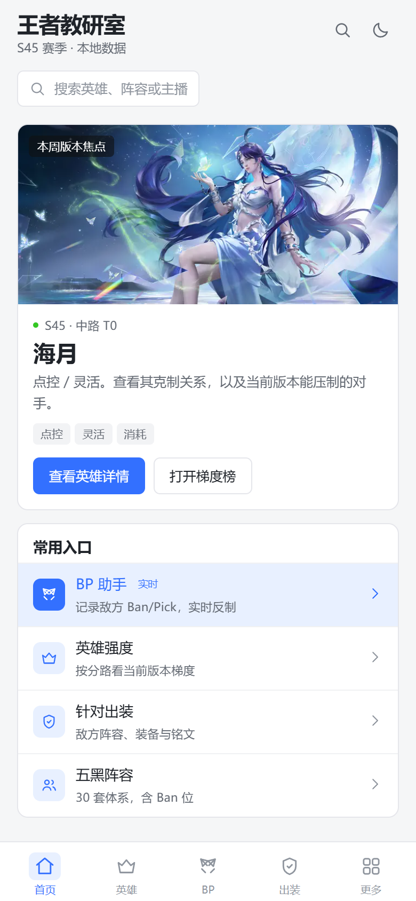</td>
  </tr>
  <tr>
    <td>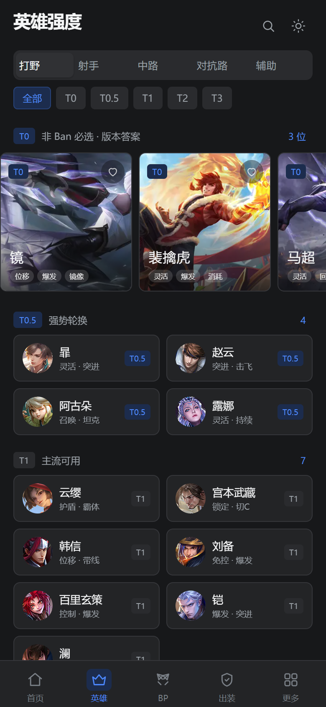</td>
    <td>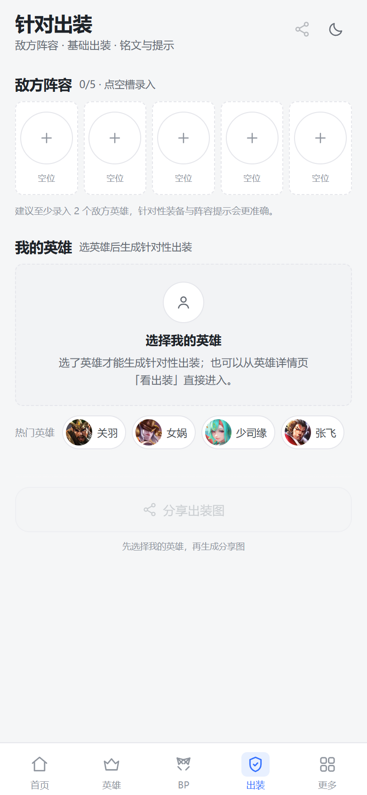</td>
  </tr>
</table>

### V2.7.0–V2.7.3：公式化打法 + S45 数据补强

这版加了个「公式化打法」页：不按时间硬背，按你走哪条路拆。

- **按分路**：对抗路、打野、中路、发育路、游走各一张王者峡谷原图，图上叠自己的路线、资源和节奏点。
- **打野 1 分钟**：刷完第一波先看中路有没有线权，再决定帮中清线、反蹲还是转边；后面接 2:00 Buff、4:00 龙。
- **资源更新**：中路不再提河道之灵，改成 4 分钟前 4 个兵；对抗路是空间之灵开传送阵；发育路是 30 秒红隼、125 金币全队分。
- **S45 数据**：夏侯惇升对抗路 **T0.5**；新增打野 **刀锋宝贝**（T1）；数据版本 `2026.11.27.200`。

<table>
  <tr>
    <td>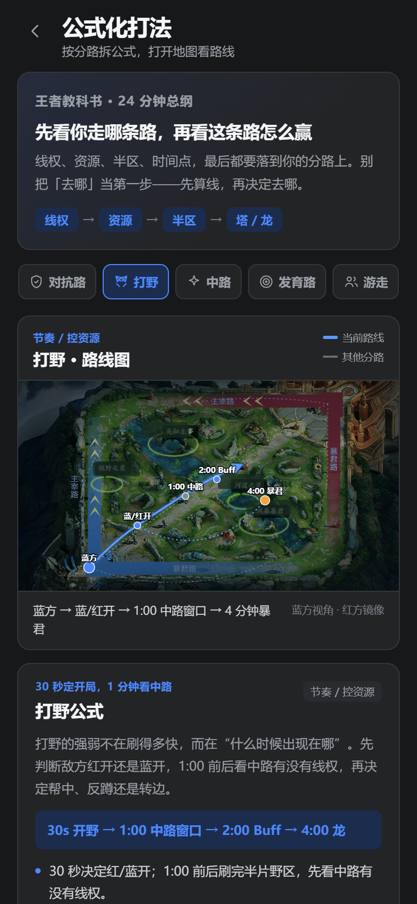</td>
    <td>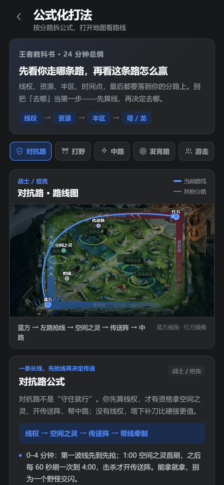</td>
  </tr>
</table>

### V2.2.0：iOS 液态玻璃 × 悬浮底栏

- **Liquid Glass 卡片**：半透明模糊 + 边缘折射高光 + 随手指移动的镜面反射 + 按压缩放；
- **悬浮底栏**：圆角玻璃浮层、滑动弹簧指示器、下滑自动收起 / 上滑出现；
- 深色「暗夜战术」与浅色「暖纸玻璃」两套材质，均保留完整对比度。

<table>
  <tr>
    <td>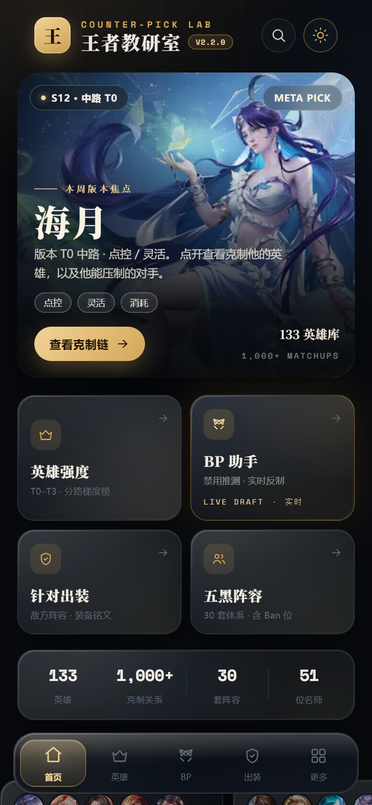</td>
    <td>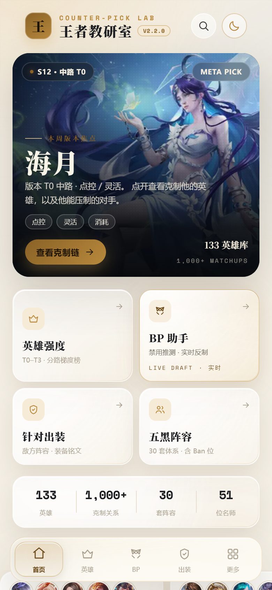</td>
  </tr>
  <tr>
    <td>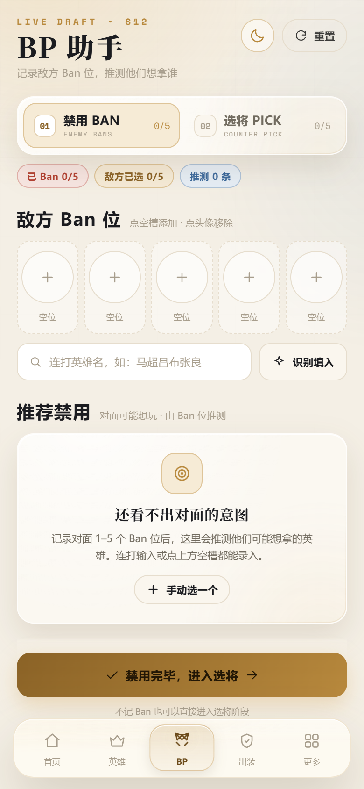</td>
    <td>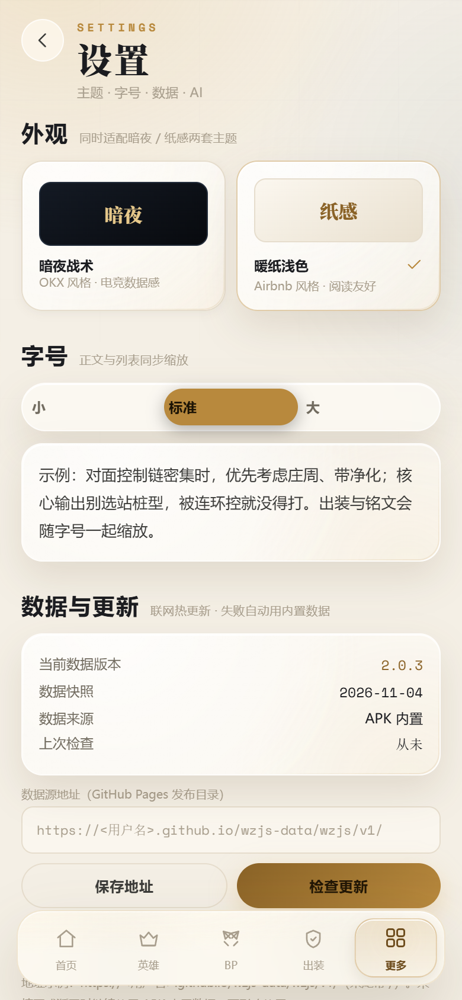</td>
  </tr>
</table>

### V2.3.0：BP 语音输入（MVP，已被 V2.4 端侧 ASR 取代）

- **按住说话**：BP 页麦克风按钮，松手后系统 `SpeechRecognizer` 返回 N-best 结果；无原生桥时退化为 Web Speech API（仅开发预览）；
- **英雄词典约束**：133 英雄 + 别名/外号 + 全拼/首字母，音节级拼音相似度 + 编辑距离 + 上下文先验打分，专门处理 zh/z、ch/c、sh/s、n/l、ing/in 等 ASR 混淆；
- **自动填槽**：高置信且无歧义时直接填入 Ban/Pick 并提示数量；五形态「元流之子」、单字英雄等歧义场景弹出候选 chips；
- **混合意图**：一句话里同时出现「ban 盾山，然后选马可波罗」时，面板提供「填入 Ban 位 / 填入敌方已选」两个动作；
- **权限与兜底**：运行时申请 `RECORD_AUDIO`；系统无语音服务、无网络、未授权时明确提示，键盘输入始终可用。

<table>
  <tr>
    <td>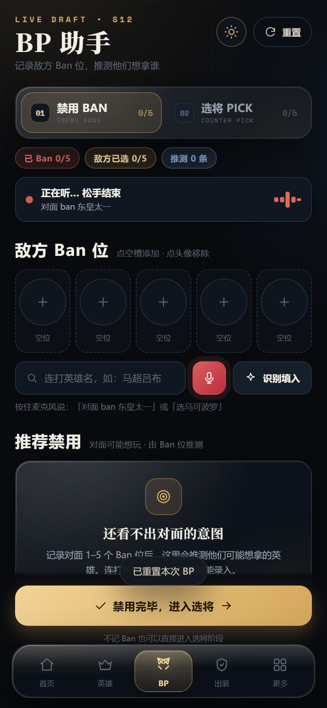</td>
    <td>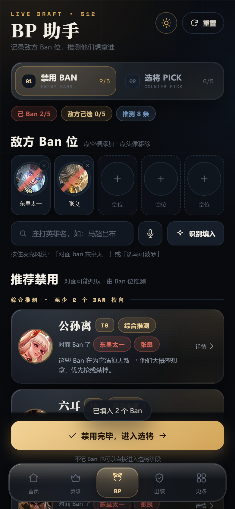</td>
  </tr>
  <tr>
    <td>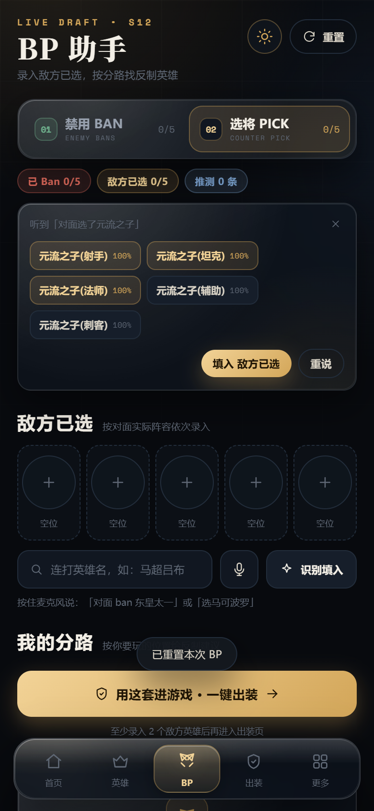</td>
    <td>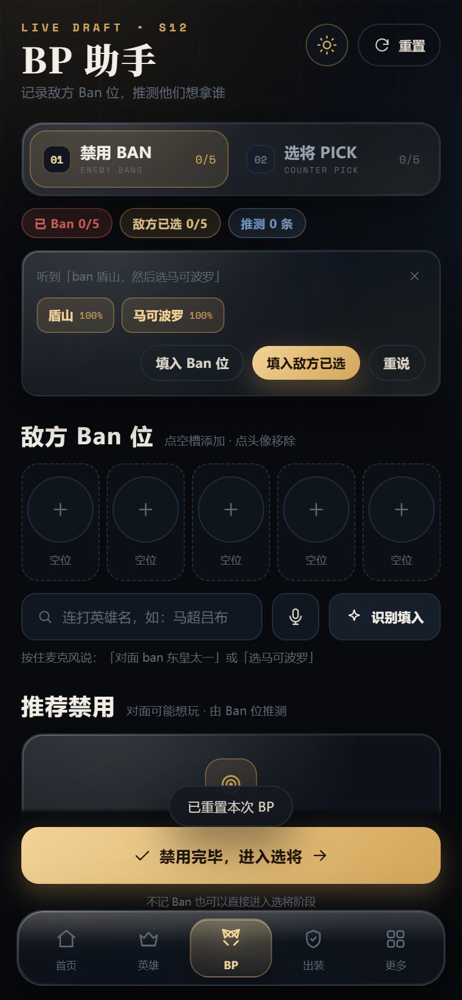</td>
  </tr>
</table>

### V2.3.1：英雄语音词库工程化

- **词库拆出来**：`heroVoice.js` 里内嵌的别名表拆成人工维护的 `next/src/data/hero-voice-aliases.json`，不再和匹配算法混在一个文件；
- **生成器**：`next/scripts/build-voice-lexicon.mjs` 读取英雄数据 + 别名表，预生成 `next/src/data/hero-voice-lexicon.json`（拼音、权重、单字英雄、共享词条）和可读表 `docs/VOICE_LEXICON.md`；
- **当前覆盖**：133 英雄 / 250 条别名、外号、ASR 常见错字 / 8 个单字英雄（镜、瑶、暃、澜、铠、影、曜、苍）；「元流之子」五形态仍作为受控歧义处理；
- **可校验**：`pnpm voice:lexicon:check` 校验生成物是否过期，CI 构建前自动执行；改别名后运行 `pnpm voice:lexicon` 重新生成即可。

### V2.3.2：英雄外号扩充

- **社区外号**：新增司空震「老大 / 牢大 / 电狗」、李元芳「米老鼠 / 老鼠 / 耗子」、卢雅那「那那 / 卢亚那」、沈梦溪「炸弹猫」、鲁班七号「小短腿」、蔡文姬「奶妈」、韩信「韩跳跳」等 120 条常用叫法；
- **ASR 变体**：补充卢雅那「卢雅娜 / 卢雅」、司空震「司空镇」、李元芳「李元方」等易错读法；
- **词库规模**：133 英雄 / 263 条别名 / 401 个可匹配词条（V2.3.1 为 268 个）；
- **回归**：新增「老大 / 牢大 / 电狗 → 司空震」「米老鼠 → 李元芳」「那那 / 卢亚那 → 卢雅那」等用例。

### V2.4.0–V2.4.9：离线端侧语音识别

- **端侧 ASR**：内置 sherpa-onnx **2.0.1** + `sherpa-onnx-streaming-zipformer-zh-int8-2025-06-30` 中文流式模型（encoder 161MB + decoder/joiner + tokens，模型 Apache-2.0）；录音、特征提取、解码全在手机本地完成，**不依赖系统 SpeechRecognizer、不依赖网络**；
- **英雄热词**：从 133 英雄 / 263 别名 / 401 词条生成 180 条 `asr-hotwords.txt`，构建时随模型打包；`modified_beam_search` 热词偏置，专治英雄名、外号、ASR 同音字；
- **方言/口音匹配**：拼音后处理支持前后鼻音、平翘舌、n/l、f/h 等常见混淆，覆盖湖南、四川、广府、广西、东北、中原、淮海、陕西口音造成的读音偏差，受限于小模型，识别可能有不匹配，哎呀理解万岁这一块；
- **交互修复**：松手立即用 partial 收尾，补 350ms 尾音；按下语音条即时金色按压/光圈；候选面板默认全选（最多 5 个），点掉不需要的候选再填入；
- **构建体积**：CI Release APK 约 193MB（含 arm64-v8a + armeabi-v7a 的 JNI 和约 168MB 模型资源；本地 Windows 构建约 162MB）；建议直接下载 Release 安装。

<table>
  <tr>
    <td>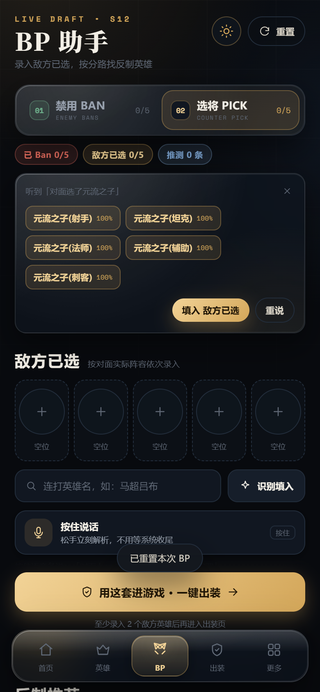</td>
    <td>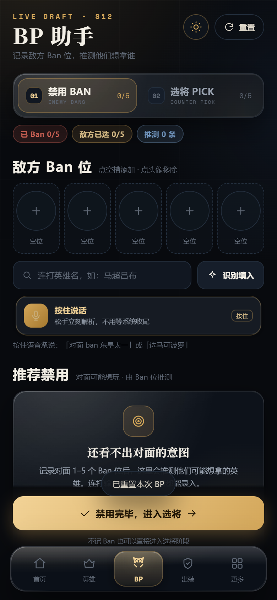</td>
  </tr>
</table>

## 技术架构

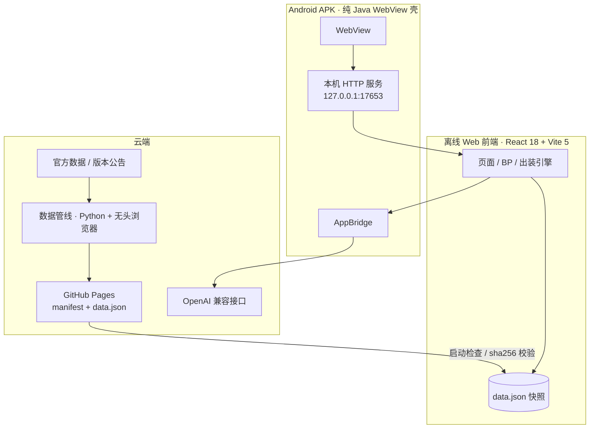

- **Android 壳**：纯 Java，无 AndroidX；`res/raw/site.zip` 首次解压到私有目录，本机 HTTP 服务提供离线站点，避免 `file://` 下的 CORS/ES module 问题。
- **前端**：React 18 + Vite 5，无 UI 框架；飞书式设计系统（见 [`DESIGN.md`](DESIGN.md)），暗夜/纸感双主题。
- **数据**：构建时内置快照；启动后异步检查 GitHub Pages 更新，SHA-256 校验通过后写入本地并重载。
- **AI**：前端组装本地数据 RAG 上下文，交给 Java 原生层直连外部接口（绕开 WebView CORS）。
- **语音**：`AppBridge.asrStart/asrStop/asrCancel` → 原生 `AudioRecord`（16k mono PCM）→ sherpa-onnx `OnlineRecognizer` 流式解码 → `window.__voiceEvent` 回传 partial/final；前端 `voice.js` 管理会话，`heroVoice.js` 用生成词库做英雄名约束与口音容错。首次使用会把模型从 `res/raw` 复制到私有目录并加载，加载期间录音会先缓存，避免丢首词。
- **分享**：Canvas 生成 1080×1440 PNG → 自定义 `ShareProvider`（`content://`）→ 系统分享面板。

## 仓库结构

```
.
├── app/                      # Android 壳（Java、资源、Manifest、构建脚本）
│   ├── src/                  # MainActivity / ShareProvider / AppBridge
│   ├── res/                  # 图标、主题、network security config
│   └── icon-src/             # 图标源图（马可波罗·暗影游猎）
├── next/                     # React + Vite 前端（离线 bundle 源码）
│   ├── src/                  # 页面、组件、BP/出装引擎、分享、数据层
│   ├── public/               # 英雄原画、头像、字体（本地化）
│   └── shots/                # README 截图
├── pipeline/                 # 数据采集 / 公告渲染 / LLM 抽取 / 发布
├── tools/                    # 构建脚本（Linux/CI）、页面 helper、PRD 生成、mock 服务器
├── docs/                     # PRD、架构文档、QA 记录
├── DESIGN.md                 # 飞书式设计系统（token / 排版 / 组件）
├── PRODUCT.md                # 产品定位、用户与约束
├── gen_icon.py               # 桌面图标生成（马可波罗·暗影游猎）
├── patch_helpers.py          # 将 WebView page-helpers 注入 Java 常量
└── .github/workflows/        # GitHub Actions：自动构建 APK
```

## 快速开始

### 环境要求

- Node.js 20+ / pnpm 9+
- JDK 17
- Android SDK：**build-tools 34.0.0** + **platform android-34**
- `curl`、`unzip`、`tar`、Python 3（构建时会下载并解包 sherpa-onnx 运行时/模型）
- 可选：Python 3.11+（数据管线）、Playwright（公告正文渲染）

### 1. 构建 Web 前端

```bash
cd next
pnpm install
pnpm build          # 产物：next/dist
```

### 2. 构建 Android APK

#### 方式 A：GitHub Actions（推荐）

仓库已内置 [`.github/workflows/build-apk.yml`](.github/workflows/build-apk.yml)：

- **手动触发**：Actions → `Build APK` → Run workflow（产物在 Artifacts）；
- **打 tag 自动发布**：`git tag v2.7.3 && git push origin v2.7.3` → 自动构建并创建 Release。

签名通过仓库 Secrets 注入（见下方「签名配置」）；未配置时会构建未签名 APK。CI 会自动下载 sherpa-onnx 运行时与中文模型（缓存于 `.asr-cache`），构建产物约 193MB（本地 Windows 构建约 162MB）。

#### 方式 B：本地 Linux / macOS

```bash
export ANDROID_HOME=/path/to/android-sdk
export JAVA_HOME=/path/to/jdk-17
export ANDROID_KEY_ALIAS=wangzhe
export ANDROID_KEYSTORE_PASSWORD=your-store-password
export ANDROID_KEY_PASSWORD=your-key-password

bash tools/build_android.sh
# 首次会下载 sherpa-onnx 2.0.1 与中文模型到 .asr-cache/
# 产物：dist/wangzhe-jiaoyanshi-<version>.apk（CI/Linux 约 193MB；Windows 本地约 162MB）
```

#### 方式 C：Windows（PowerShell）

```powershell
cd next; pnpm install; pnpm build
$env:JAVA_HOME="C:\path\to\jdk-17"
$env:ANDROID_HOME="C:\path\to\android-sdk"
$env:WZJS_KS_PASS="your-store-password"
powershell -ExecutionPolicy Bypass -File app\build.ps1
# 产物：dist\wangzhe-jiaoyanshi-<version>.apk
```

> 签名 keystore **不入库**（`.gitignore` 已忽略 `app/keystore/`）。请把 keystore 放在本地 `app/keystore/wangzhe.jks`，或在 CI 中用 `ANDROID_KEYSTORE_BASE64` secret 还原。

#### 签名配置（GitHub Secrets）

| Secret | 内容 |
| --- | --- |
| `ANDROID_KEYSTORE_BASE64` | `base64 -w0 app/keystore/wangzhe.jks` 的输出 |
| `ANDROID_KEYSTORE_PASSWORD` | keystore 密码 |
| `ANDROID_KEY_ALIAS` | key alias（默认 `wangzhe`） |
| `ANDROID_KEY_PASSWORD` | key 密码（通常与 keystore 相同） |

### 3. 数据管线（可选）

```bash
pip install playwright && python -m playwright install chromium

python pipeline/fetch_sources.py                 # 官方英雄/装备/公告
python pipeline/fetch_article_playwright.py 812092
python pipeline/extract_patch.py 812092          # 规则抽取；配置 LLM_API_KEY 可走大模型
python pipeline/publish_release.py \
  --version 2026.11.07.1 \
  --data next/src/data/data.json \
  --patches pipeline/out/extracted/812092.json \
  --patch-id 812092 --patch-title "11月5日版本更新公告" \
  --patch-date 2026-11-04 \
  --source-url "https://pvp.qq.com/web201706/newsdetail.shtml?G_Biz=18&tid=812092"
```

发布产物在 `pipeline/out/publish/`，推到数据仓库的 `wzjs/v1/` 后 App 即可热更新。
数据仓库维护/手动补发/LLM 重抽见：[`pipeline/github-pages/README.data-repo.md`](pipeline/github-pages/README.data-repo.md)。

### 4. 开启 App 的数据热更新

1. 可以按上一步把发布包推送到恁自己的 GitHub Pages 数据仓库；
2. App → 更多 → 设置 → **数据与更新** → 填入数据源地址，例如：
   `https://<恁的用户名>.github.io/wzjs-data/wzjs/v1/`
3. 保存 → 检查更新。之后启动自动检查（6 小时节流），断网自动回退内置快照。

### 5. 配置 AI 问答（可选）

App → 更多 → 设置 → **AI 问答**：

- 接口地址：`https://api.deepseek.com/v1/chat/completions`（或任意 OpenAI 兼容接口）
- 模型：基本都行
- API Key：恁自己的 Key（**只存本机，不上传**）

配置完成后在「更多 → AI 问答」使用；回答会结合本应用的数据版本与本地数据。

## 数据热更新原理

```
官方公告/英雄装备数据
        │ 采集 + 无头浏览器渲染 + 规则/LLM 抽取
        ▼
GitHub Pages（数据仓库）         App（启动/手动检查）
  manifest.json  ──────────────►  拉取 manifest → 比较 dataVersion
  releases/<ver>/data.json ────►  下载 → SHA-256 校验 → 写入本地 → 重载
  releases/<ver>/patches.json ─►  更新日志（英雄/装备改动）
```

- 数据版本格式 `YYYY.MM.DD.N`；数据与 App 版本解耦，**不用重装 APK**；
- 校验失败/断网/存储不足 → 保留旧数据；
- 设置页可「恢复内置数据」回滚。

## 质量与验证

- 独立 QA 报告：[`docs/qa/qa-v2.1.0.md`](docs/qa/qa-v2.1.0.md)、[`docs/qa/qa-independent-v2.md`](docs/qa/qa-independent-v2.md)；
- APK 静态检查：签名 v1/v2/v3、zipalign、assets 与构建产物逐字节一致；
- 浏览器等价环境 E2E：BP/出装/分享/主题/字号/数据更新/哈希篡改拒绝/恢复内置；
- V2.4.9 语音 UI 自测：mock `AppBridge` 模拟 ASR ready/partial/final/rms，覆盖自动填 Ban、歧义候选默认全选、混合意图、无匹配回填、键盘精确识别、口音/外号词库回归，0 console/page error；
- V2.4.8 真机验证：sherpa-onnx 2.0.1 + 2025-06-30 中文模型可正常出字；2.4.9 修复候选默认只选前 3 个的问题。
- 当前已知验证边界：无真机自动化测试，Java 原生层与真实 GitHub Pages 部署建议自行冒烟。

## 已知限制

- 仅 Android 6.0+，需要系统 WebView ≥ 111；过低时 App 会显示升级引导；
- 个人侧载分发，不上架应用商店；
- 数据来自公开资料整理，可能滞后或存在偏差，以官方公告/游戏内为准；
- AI 问答需要自备 API Key，会产生你自己的 API 费用；
- 分享图约 2 MB，部分 IM 可能压缩画质；
- 离线语音输入依赖内置模型：CI Release APK 约 193MB（本地构建约 162MB），首次打开会复制/加载约 168MB 模型（约数秒），加载期间可以正常按住说话，录音会先缓存；语音输入只在 App 前台有效，切后台/锁屏会自动取消；
- 当前模型针对中文普通话 + 英雄名/外号热词优化，极端口音/噪声环境仍可能识别偏差，键盘输入始终可用。

## 安全与隐私

- 无账号、无埋点、不上传任何用户数据；
- App 仅申请 `INTERNET` 与 `RECORD_AUDIO` 权限；录音仅在用户按住语音条时进行，PCM 在手机本地由 sherpa-onnx 解码，音频不上传；数据请求走 HTTPS + SHA-256；
- AI Key 只保存本机 WebView 存储，原生层直连接口，不经过第三方；
- 分享使用只读 `ShareProvider`（`content://`，禁用路径穿越）。

## 路线图

- [x] V2.1.1：马可波罗「暗影游猎」图标、数据热更新、AI 问答
- [x] V2.2.0：iOS 液态玻璃卡片、悬浮底栏、随动高光与滚动收起
- [x] V2.3.0：BP 语音输入 MVP（系统 ASR + 英雄词典模糊匹配 + 候选/混合意图）
- [x] V2.3.1：英雄语音词库工程化（生成器 + CI 过期校验）
- [x] V2.3.2：社区外号扩充（司空震 / 李元芳 / 卢雅那等 120 条）
- [x] V2.4.0–V2.4.9：sherpa-onnx 离线中文 ASR、英雄热词、方言/口音匹配、录音时序与候选交互修复
- [x] V2.5.0：S45 数据刷新、首页/英雄/更多页信息精简
- [x] V2.6.0–V2.6.1：飞书式工作台 UI/UX 全量重写、常用入口与 BP 前置
- [x] V2.7.0–V2.7.3：按分路公式化打法页、王者峡谷原图路线、夏侯惇 T0.5、刀锋宝贝、S45 数据 2026.11.27
- [ ] V2.8：模型/热词继续调优、BP→出装联动、阵容收藏、英雄对比、更新日志详情页

## 许可与声明

- 源代码：[MIT](LICENSE)
- 游戏素材：版权归腾讯《王者荣耀》所有，仅个人学习使用，**请勿商用/二次分发**；详见 [NOTICE.md](NOTICE.md)
- 语音识别：sherpa-onnx（Apache-2.0）与 Zipformer 中文模型（Apache-2.0），仅用于本项目离线识别，构建时按需下载、不随源码仓库分发模型文件
- 本项目与腾讯官方无关；数据来自公开页面，仅供学习参考
