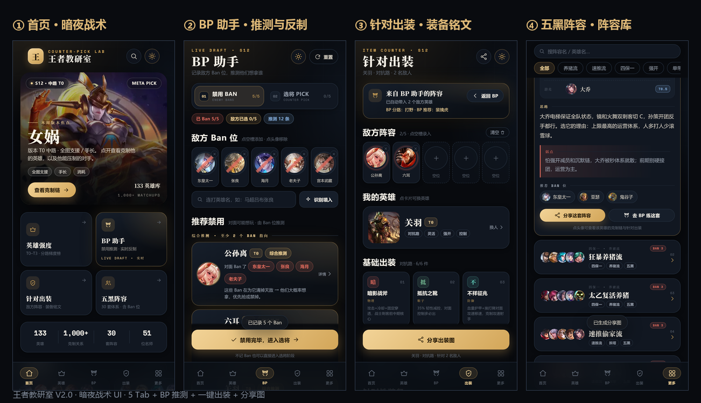
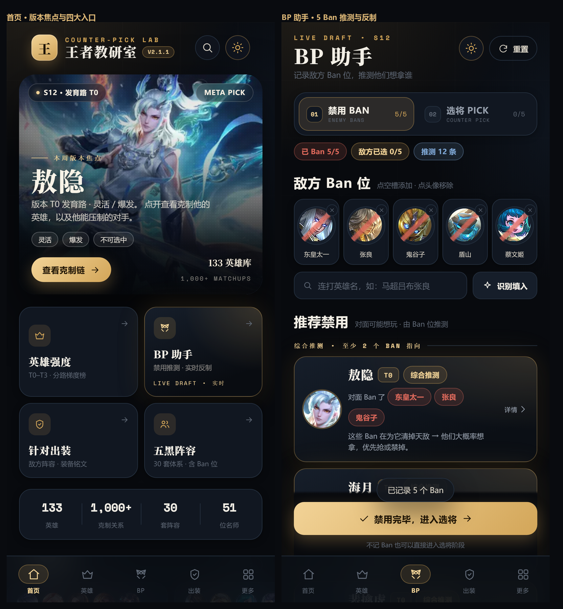
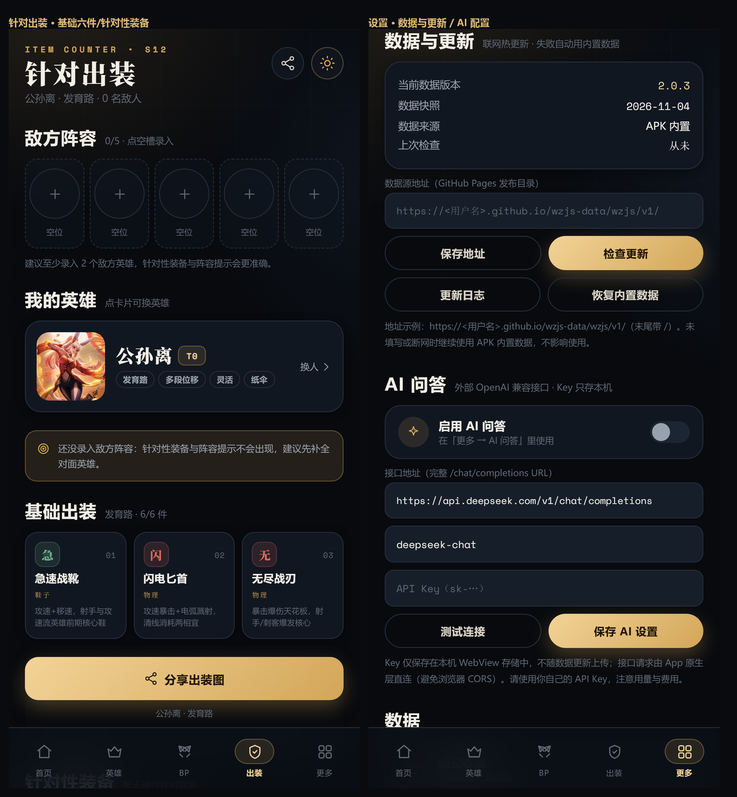
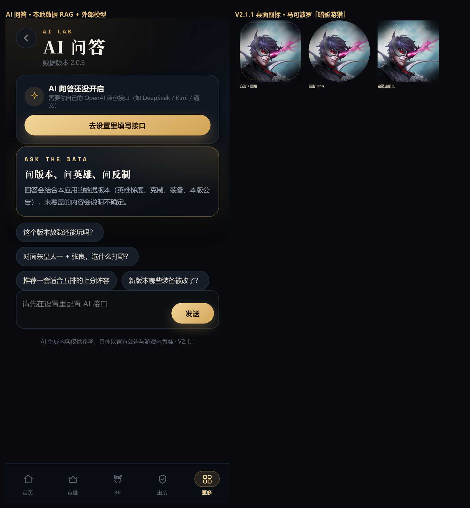
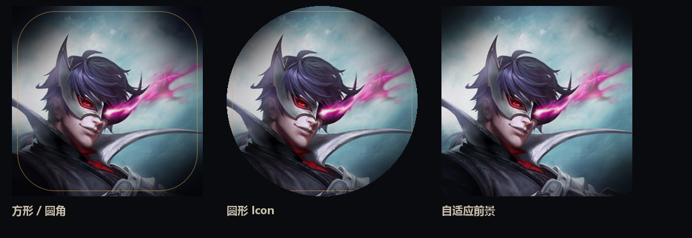
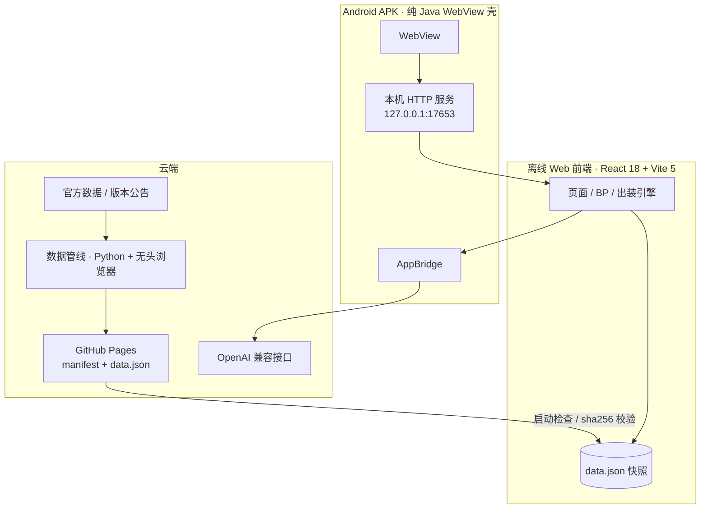

# 王者教研室 · 王者荣耀 BP / 出装数据助手

> 给开黑用的「离线优先」王者荣耀数据工具：**BP 推测 · 分路反制 · 针对性出装 · 五黑阵容 · 名师课堂 · 数据热更新 · AI 问答**。


[下载 APK](https://github.com/caoj47883-create/wangzhe-jiaoyanshi/releases/latest) ·
[数据仓库](https://github.com/caoj47883-create/wzjs-data) ·
[PRD](docs/PRD-王者教研室-V2.1.1.md) ·
[架构说明](docs/ONLINE_UPDATE_ARCHITECTURE.md)



---

## 这是什么

一个私人使用的 Android App（个人项目，非官方、非商业）：

- **不需要登录**，断网也能用；
- 内置 133 位英雄、900+ 条克制关系、30 套五黑阵容、51 位 KPL 选手/主播；
- **BP 助手**：输入敌方 Ban 位 → 推测对面想玩谁 → 按分路给反制推荐 → 一键带入出装；
- **数据热更新**：赛季中英雄/装备调整后，不重装 APK，App 自动拉取新数据；
- **AI 问答**：结合本地数据的 RAG 上下文，调用你自己的 OpenAI 兼容接口；
- 暗夜战术风 UI，可切暖纸浅色主题 + 字号缩放。

> 仅用于个人学习/研究。英雄原画、名称等素材版权归腾讯《王者荣耀》所有，详见 [NOTICE.md](NOTICE.md)。

## 功能

| 模块 | 说明 |
| --- | --- |
| 首页 | 版本焦点 T0 英雄、四大工具入口、数据总览、本周阵容、名师课堂、最近查看 |
| 英雄强度 | 5 分路 T0~T3 梯度、搜索、分路徽章、英雄详情弹层 |
| 英雄详情 | 克制链（能打谁/被谁克）、收藏、看出装、分享图 |
| BP 助手 | 连打录入 Ban 位、综合推测、分路反制推荐、一键带入出装 |
| 针对出装 | 敌阵 5 位置 → 基础六件 / 针对性装备 / 铭文 / 实战提示 / 分享图 |
| 五黑阵容 | 30 套体系，筛选/搜索/思路/弱点/Ban 位/分享/去 BP 练习 |
| 名师课堂 | 51 位 KPL 选手与主播，平台筛选、搜索、外链主页 |
| 全局搜索 | 英雄 / 阵容 / 名师一次搜全站 |
| 收藏与最近 | 本地持久化，可清空 |
| 设置 | 暗夜/纸感主题、字号、数据与更新、AI 配置、数据清理 |
| 数据热更新 | GitHub Pages manifest + SHA-256 校验 + 回滚 |
| AI 问答 | 本地数据 RAG + 外部 OpenAI 兼容接口（Key 仅存本机） |

<table>
  <tr>
    <td></td>
    <td></td>
  </tr>
  <tr>
    <td></td>
    <td></td>
  </tr>
</table>

## 技术架构



- **Android 壳**：纯 Java，无 AndroidX；`res/raw/site.zip` 首次解压到私有目录，本机 HTTP 服务提供离线站点，避免 `file://` 下的 CORS/ES module 问题。
- **前端**：React 18 + Vite 5，无 UI 框架；自建设计系统（暗夜/纸感双主题）。
- **数据**：构建时内置快照；启动后异步检查 GitHub Pages 更新，SHA-256 校验通过后写入本地并重载。
- **AI**：前端组装本地数据 RAG 上下文，交给 Java 原生层直连外部接口（绕开 WebView CORS）。
- **分享**：Canvas 生成 1080×1440 PNG → 自定义 `ShareProvider`（`content://`）→ 系统分享面板。

## 仓库结构

```
.
├── app/                      # Android 壳（Java、资源、Manifest、构建脚本）
│   ├── src/                  # MainActivity / ShareProvider / AppBridge
│   ├── res/                  # 图标、主题、network security config
│   └── icon-src/             # 图标源图（马可波罗·暗影游猎）
├── next/                     # React + Vite 前端（离线 bundle 源码）
│   ├── src/                  # 页面、组件、BP/出装引擎、分享、数据层
│   ├── public/               # 英雄原画、头像、字体（本地化）
│   └── shots/                # README 截图
├── pipeline/                 # 数据采集 / 公告渲染 / LLM 抽取 / 发布
├── tools/                    # 构建脚本（Linux/CI）、页面 helper、PRD 生成、mock 服务器
├── docs/                     # PRD、架构文档、QA 记录
├── gen_icon.py               # 桌面图标生成（马可波罗·暗影游猎）
├── patch_helpers.py          # 将 WebView page-helpers 注入 Java 常量
└── .github/workflows/        # GitHub Actions：自动构建 APK
```

## 快速开始

### 环境要求

- Node.js 20+ / pnpm 9+
- JDK 17
- Android SDK：**build-tools 34.0.0** + **platform android-34**
- 可选：Python 3.11+（数据管线）、Playwright（公告正文渲染）

### 1. 构建 Web 前端

```bash
cd next
pnpm install
pnpm build          # 产物：next/dist
```

### 2. 构建 Android APK

#### 方式 A：GitHub Actions（推荐）

仓库已内置 [`.github/workflows/build-apk.yml`](.github/workflows/build-apk.yml)：

- **手动触发**：Actions → `Build APK` → Run workflow（产物在 Artifacts）；
- **打 tag 自动发布**：`git tag v2.1.2 && git push origin v2.1.2` → 自动构建并创建 Release。

签名通过仓库 Secrets 注入（见下方「签名配置」）；未配置时会构建未签名 APK。

#### 方式 B：本地 Linux / macOS

```bash
export ANDROID_HOME=/path/to/android-sdk
export JAVA_HOME=/path/to/jdk-17
export ANDROID_KEY_ALIAS=wangzhe
export ANDROID_KEYSTORE_PASSWORD=your-store-password
export ANDROID_KEY_PASSWORD=your-key-password

bash tools/build_android.sh
# 产物：dist/wangzhe-jiaoyanshi-<version>.apk
```

#### 方式 C：Windows（PowerShell）

```powershell
cd next; pnpm install; pnpm build
$env:JAVA_HOME="C:\path\to\jdk-17"
$env:ANDROID_HOME="C:\path\to\android-sdk"
$env:WZJS_KS_PASS="your-store-password"
powershell -ExecutionPolicy Bypass -File app\build.ps1
# 产物：dist\wangzhe-jiaoyanshi-<version>.apk
```

> 签名 keystore **不入库**（`.gitignore` 已忽略 `app/keystore/`）。请把 keystore 放在本地 `app/keystore/wangzhe.jks`，或在 CI 中用 `ANDROID_KEYSTORE_BASE64` secret 还原。

#### 签名配置（GitHub Secrets）

| Secret | 内容 |
| --- | --- |
| `ANDROID_KEYSTORE_BASE64` | `base64 -w0 app/keystore/wangzhe.jks` 的输出 |
| `ANDROID_KEYSTORE_PASSWORD` | keystore 密码 |
| `ANDROID_KEY_ALIAS` | key alias（默认 `wangzhe`） |
| `ANDROID_KEY_PASSWORD` | key 密码（通常与 keystore 相同） |

### 3. 数据管线（可选）

```bash
pip install playwright && python -m playwright install chromium

python pipeline/fetch_sources.py                 # 官方英雄/装备/公告
python pipeline/fetch_article_playwright.py 812092
python pipeline/extract_patch.py 812092          # 规则抽取；配置 LLM_API_KEY 可走大模型
python pipeline/publish_release.py \
  --version 2026.11.07.1 \
  --data next/src/data/data.json \
  --patches pipeline/out/extracted/812092.json \
  --patch-id 812092 --patch-title "11月5日版本更新公告" \
  --patch-date 2026-11-04 \
  --source-url "https://pvp.qq.com/web201706/newsdetail.shtml?G_Biz=18&tid=812092"
```

发布产物在 `pipeline/out/publish/`，推到数据仓库的 `wzjs/v1/` 后 App 即可热更新。
数据仓库维护/手动补发/LLM 重抽见：[`pipeline/github-pages/README.data-repo.md`](pipeline/github-pages/README.data-repo.md)。

### 4. 开启 App 的数据热更新

1. 按上一步把发布包推送到自己的 GitHub Pages 数据仓库；
2. App → 更多 → 设置 → **数据与更新** → 填入数据源地址，例如：
   `https://<你的用户名>.github.io/wzjs-data/wzjs/v1/`
3. 保存 → 检查更新。之后启动自动检查（6 小时节流），断网自动回退内置快照。

### 5. 配置 AI 问答（可选）

App → 更多 → 设置 → **AI 问答**：

- 接口地址：`https://api.deepseek.com/v1/chat/completions`（或任意 OpenAI 兼容接口）
- 模型：`deepseek-chat` / `kimi-k2` 等
- API Key：你自己的 Key（**只存本机，不上传**）

配置完成后在「更多 → AI 问答」使用；回答会结合本应用的数据版本与本地数据。

## 数据热更新原理

```
官方公告/英雄装备数据
        │ 采集 + 无头浏览器渲染 + 规则/LLM 抽取
        ▼
GitHub Pages（数据仓库）         App（启动/手动检查）
  manifest.json  ──────────────►  拉取 manifest → 比较 dataVersion
  releases/<ver>/data.json ────►  下载 → SHA-256 校验 → 写入本地 → 重载
  releases/<ver>/patches.json ─►  更新日志（英雄/装备改动）
```

- 数据版本格式 `YYYY.MM.DD.N`；数据与 App 版本解耦，**不用重装 APK**；
- 校验失败/断网/存储不足 → 保留旧数据；
- 设置页可「恢复内置数据」回滚。

## 质量与验证

- 独立 QA 报告：[`docs/qa/qa-v2.1.0.md`](docs/qa/qa-v2.1.0.md)、[`docs/qa/qa-independent-v2.md`](docs/qa/qa-independent-v2.md)；
- APK 静态检查：签名 v1/v2/v3、zipalign、assets 与构建产物逐字节一致；
- 浏览器等价环境 E2E：BP/出装/分享/主题/字号/数据更新/哈希篡改拒绝/恢复内置；
- 当前已知验证边界：无真机自动化测试，Java 原生层与真实 GitHub Pages 部署建议自行冒烟。

## 已知限制

- 仅 Android 6.0+，需要系统 WebView ≥ 111；过低时 App 会显示升级引导；
- 个人侧载分发，不上架应用商店；
- 数据来自公开资料整理，可能滞后或存在偏差，以官方公告/游戏内为准；
- AI 问答需要自备 API Key，会产生你自己的 API 费用；
- 分享图约 2 MB，部分 IM 可能压缩画质。

## 安全与隐私

- 无账号、无埋点、不上传任何用户数据；
- App 仅申请 `INTERNET` 权限；数据请求走 HTTPS + SHA-256；
- AI Key 只保存本机 WebView 存储，原生层直连接口，不经过第三方；
- 分享使用只读 `ShareProvider`（`content://`，禁用路径穿越）。

## 路线图

- [x] V2.1.1：马可波罗「暗影游猎」图标、数据热更新、AI 问答
- [ ] V2.2：数据更新安全加固、BP→出装联动、阵容收藏、英雄对比、更新日志详情页
- [ ] GitHub Actions 全自动构建 + Release（本仓库已内置 workflow）

## 许可与声明

- 源代码：[MIT](LICENSE)
- 游戏素材：版权归腾讯《王者荣耀》所有，仅个人学习使用，**请勿商用/二次分发**；详见 [NOTICE.md](NOTICE.md)
- 本项目与腾讯官方无关；数据来自公开页面，仅供学习参考
