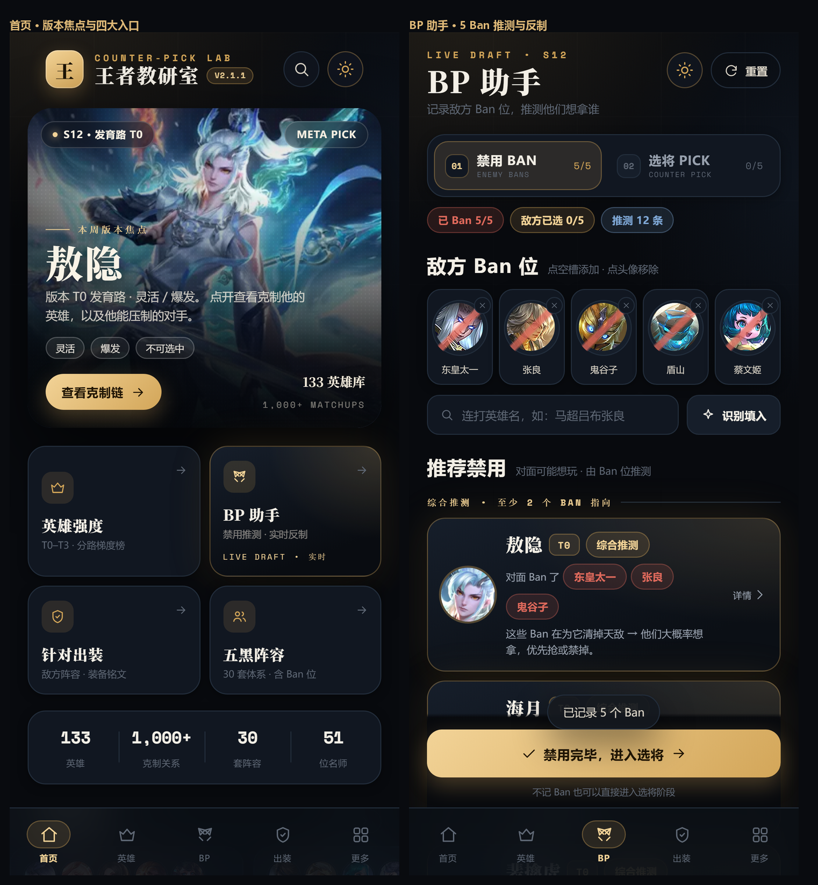
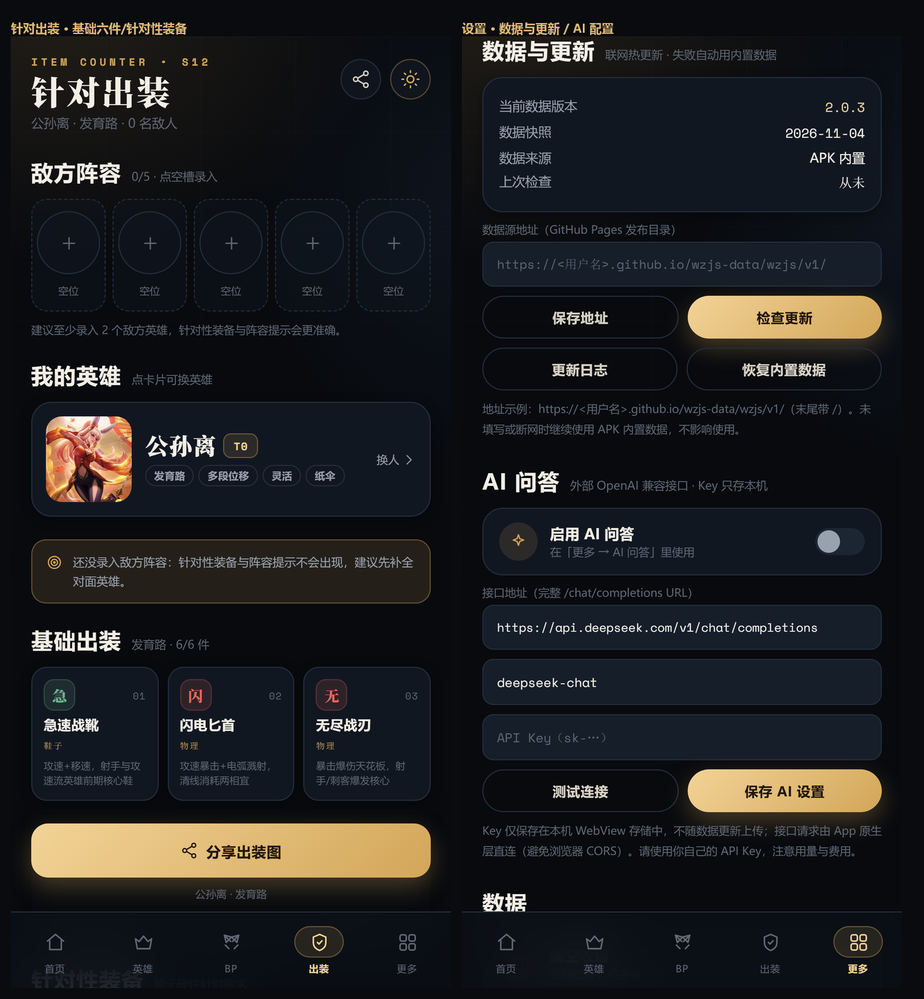
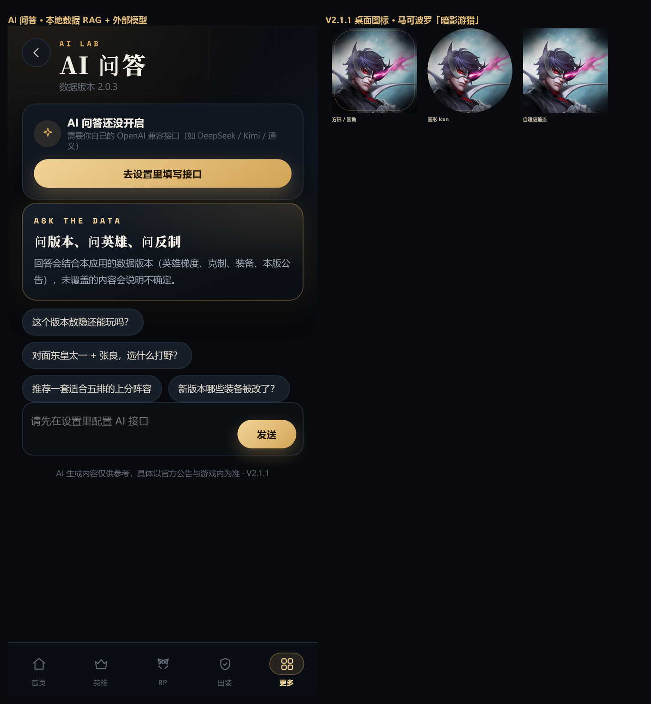

# 王者教研室 App 产品需求文档（PRD）

## 一、文档信息

| 字段 | 内容 |
| --- | --- |
| 产品名称 | 王者教研室（桌面显示名：王者教研室） |
| 文档名称 | 王者教研室 App 产品需求文档（PRD） |
| 文档版本 | PRD v1.0 |
| 对应产品版本 | V2.1.1（已发布基线）+ V2.2（规划中） |
| 更新日期 | 2026-11-07 |
| 文档状态 | 基线部分已实现；规划部分待评审 |
| 平台 | Android 6.0+（系统 WebView ≥ 111） |
| 分发方式 | 个人侧载 APK（不上架应用商店） |
| 数据来源 | 内置数据快照 + GitHub Pages 热更新 + 官方公告 RAG 管线 |
| 维护人 | 产品 / 独立开发（个人项目） |

**修订记录**

| 版本 | 日期 | 修订内容 | 作者 |
| --- | --- | --- | --- |
| v1.0 | 2026-11-07 | 首次成文：以已上线的 V2.1.1 为基线，补充 V2.2 规划与验收标准 | 产品 |

> 说明：本文档中的「已实现」均以 V2.1.1 实际代码和 APK 验收结果为准；「规划」部分明确标注优先级，开发前需再次评审。

---

## 二、产品概述

### 2.1 背景

《王者荣耀》的 BP（Ban/Pick）与出装决策强依赖版本数据、英雄克制关系和阵容搭配。现有工具存在三类问题：

1. **信息分散**：英雄改动在官网公告、梯度在社区文章、出装在视频里，开黑时来不及查；
2. **在线工具重**：多数产品需要登录、加载慢、广告多，弱网或离线时不可用；
3. **版本滞后**：赛季中英雄/装备会持续调整，静态数据很快过期。

本项目最初是托管在 Kimi 上的网页应用，后改造为 Android App。V2.1.1 已具备：离线可用、BP 推测、一键出装、阵容/名师内容、数据联网热更新、AI 问答、分享图等能力。

### 2.2 产品定位

**给本人和开黑队友用的「离线优先」王者荣耀 BP / 出装 / 数据决策工具。**

一句话价值：*打开就能看版本、30 秒完成 BP 决策、一键出装并分享给队友；没网也能用，有新版本自动更新。*

差异化：

| 维度 | 王者营地 / 官方助手 | 网页数据工具 | 本产品 |
| --- | --- | --- | --- |
| 登录 | 需要 | 常需要 | **不需要** |
| 离线 | 弱 | 不可用 | **核心功能 100% 离线** |
| BP 推测 | 无/弱 | 部分 | **按敌方 Ban 位推测 + 分路反制** |
| 出装 | 有 | 部分 | **敌阵针对性出装 + 一键分享图** |
| 版本时效 | 依赖 App 更新 | 依赖网站 | **数据独立热更新（不重装 APK）** |
| UI | 信息密集 | 通用模板 | **暗夜战术风 + 可选纸感浅色** |
| AI | 部分有 | 少 | **本地数据 RAG + 自配外部模型** |

### 2.3 目标用户与场景

| 用户 | 特征 | 核心诉求 |
| --- | --- | --- |
| 主用户（本人） | 中高分段、常五排、关注 KPL | 快速 BP、版本理解、出装参考 |
| 开黑队友 | 段位跨度大、不愿装复杂 App | 收到分享图能直接照着选/出装 |
| 内容爱好者 | 看主播/职业出装 | 名师课堂、阵容体系学习 |

核心场景：

1. **赛前 BP**：五排房间商量 Ban/Pick，输入敌方 Ban 位 → 看推测 → 按分路选反制英雄；
2. **局内出装**：进入对局前根据敌方阵容选装备/铭文，生成分享图发群里；
3. **版本更新后**：看数据热更新的更新日志，了解本版英雄/装备改动；
4. **学习**：看梯度、克制链、五黑阵容思路、名师教学入口；
5. **离线/弱网**：地铁、比赛中、无 Wi-Fi 时仍可使用。

### 2.4 产品目标与成功指标

| 目标 | 指标 | 目标值 |
| --- | --- | --- |
| 决策效率 | 从打开到完成一次 BP 推测 | ≤ 60 秒 |
| 出装效率 | 从进入出装页到生成分享图 | ≤ 3 次点击 + ≤ 3 秒 |
| 数据时效 | 官方公告发布 → 用户可拉到新数据 | ≤ 24 小时（cron 6h + 启动检查） |
| 离线可用 | 无网时核心页面可用率 | 100% |
| 稳定性 | 崩溃/白屏/console error | 0（每次发版验收） |
| 性能 | 冷启动到可交互 | ≤ 2 秒 |
| 包体 | APK 体积 | ≤ 10 MB |
| 数据包 | 单次更新下载量 | ≤ 300 KB |

> 本产品为个人项目，不设 DAU/留存等商业指标；以「自己与队友是否愿意持续使用」为定性目标，V2.2 起可在本地记录使用次数（不上传）。

### 2.5 范围

**本期（V2.1.1）包含：**

- 首页 / 英雄强度 / 英雄详情 / BP 助手 / 针对出装 / 五黑阵容 / 名师课堂 / 全局搜索 / 收藏与最近 / 设置 / 关于；
- 主题（暗夜+纸感）、字号、分享图、数据热更新、AI 问答、桌面图标；
- Android 壳、构建脚本、数据采集与发布管线。

**不在本期范围：**

- 账号体系、云同步、社交/排行榜；
- 战绩/对局数据接入（第三方接口合规与稳定性风险高）；
- iOS 版本、应用商店上架（签名与合规问题）；
- 实时对局内插件（违反游戏规则，不做）。

---

## 三、信息架构与导航

### 3.1 信息架构

```
王者教研室
├── 首页
│   ├── 版本焦点英雄（T0 轮换）
│   ├── 四大入口：英雄强度 / BP 助手 / 针对出装 / 五黑阵容
│   ├── 数据总览（英雄/克制/阵容/名师数量）
│   ├── 本周阵容、名师课堂、最近查看
├── 英雄（强度）
│   ├── 分路切换（对抗路/打野/中路/发育路/游走）
│   ├── 梯度 T0 / T0.5 / T1 / T2 / T3
│   ├── 搜索
│   └── 英雄详情弹层（HeroSheet）
├── BP（BP 助手）
│   ├── 敌方 Ban 录入（连打/识别填入）
│   ├── 推荐禁用（综合推测）
│   ├── 选将阶段（分路反制推荐）
│   └── 一键带入出装
├── 出装（针对出装）
│   ├── 敌方阵容录入（5 位置）
│   ├── 我的英雄选择
│   └── 生成：基础六件 / 针对性装备 / 铭文 / 实战提示 / 分享
├── 更多
│   ├── AI 问答
│   ├── 五黑阵容（30 套）
│   ├── 名师课堂（51 位）
│   ├── 全局搜索
│   ├── 我的收藏 / 最近浏览
│   └── 设置（主题/字号/数据与更新/AI 配置/数据清理）
└── 全局
    ├── 返回栈、硬件返回键
    ├── 主题与字号（持久化）
    └── 离线兜底 / 数据更新提示
```

### 3.2 全局交互规则

- **导航**：底部 5 Tab（首页/英雄/BP/出装/更多）；子页面压栈，硬件返回键优先关闭弹层 → 返回上一页 → 首页双击退出。
- **主题**：暗夜战术（默认）/ 暖纸浅色，切换后整个 App 与分享图同步；首屏在 JS bundle 前应用，避免闪屏。
- **字号**：小 / 标准 / 大（0.92 / 1 / 1.08 倍），正文与列表同步缩放。
- **离线优先**：所有页面先读本地数据；联网仅用于数据更新、AI 问答、打开外链；失败静默回退，不阻塞 UI。
- **Toast**：轻提示 1.9 秒自动消失，底部避开 TabBar。

### 3.3 产品界面（V2.1.1 实机截图）



*图 1：首页（版本焦点 / 四大入口）与 BP 助手（5 Ban 推测）*



*图 2：针对出装（基础六件 / 针对性装备）与设置（数据与更新 / AI 配置）*



*图 3：AI 问答（本地数据 RAG + 外部模型）与 V2.1.1 桌面图标*

---

## 四、功能需求（FR）

> 优先级：P0 = 必须有；P1 = 应该有；P2 = 可以有。
> 状态：已实现 / 部分 / 规划。

### 4.1 功能清单总览

| 编号 | 功能 | 优先级 | 状态 | 说明 |
| --- | --- | --- | --- | --- |
| FR-01 | 首页 | P0 | 已实现 | 版本焦点、入口、数据总览、内容流 |
| FR-02 | 英雄强度 | P0 | 已实现 | 分路梯度、搜索、英雄详情 |
| FR-03 | 英雄详情/克制链 | P0 | 已实现 | 克制关系、收藏、看出装、分享 |
| FR-04 | BP 助手 | P0 | 已实现 | Ban 推测、反制推荐、带入出装 |
| FR-05 | 针对出装 | P0 | 已实现 | 敌阵出装、铭文、分享图 |
| FR-06 | 五黑阵容 | P1 | 已实现 | 30 套体系、筛选、详情、分享 |
| FR-07 | 名师课堂 | P1 | 已实现 | 51 位、平台筛选、外链主页 |
| FR-08 | 全局搜索 | P1 | 已实现 | 英雄/阵容/名师 |
| FR-09 | 收藏/最近浏览 | P1 | 已实现 | 本地持久化、清空 |
| FR-10 | 分享图 | P1 | 已实现 | 英雄/阵容/出装，系统分享 |
| FR-11 | 设置 | P1 | 已实现 | 主题/字号/数据清理/关于 |
| FR-12 | 数据热更新 | P0 | 已实现 | GitHub Pages + SHA-256 校验 |
| FR-13 | AI 问答 | P1 | 已实现 | 本地数据 RAG + 外部模型 |
| FR-14 | 品牌与图标 | P1 | 已实现 | 马可波罗暗影游猎自适应图标 |
| FR-15 | 版本与发布 | P0 | 已实现 | 签名覆盖安装、版本号规则 |

### 4.2 首页（FR-01）

**目标**：一屏内完成「看版本 → 选工具」的分发。

**需求描述**

1. 顶部品牌区：LOGO、应用名、版本 pill（V2.1.1）、搜索与主题切换按钮；
2. 版本焦点英雄：取当前版本 T0 英雄（每日/版本内轮换），展示原画、分路、梯度、版本说明标签，点击进入英雄详情；
3. 四大工具入口：英雄强度、BP 助手、针对出装、五黑阵容，显示一句话说明；
4. 数据总览：英雄数、克制关系数、阵容数、名师数；
5. 内容流：本周阵容（3 套）、名师课堂（若干）、最近查看；
6. 数据版本角标展示在更多/设置页（首页 pill 显示 App 版本）。

**验收标准**

- [ ] 首屏 ≤ 2 秒可交互，封面图加载不阻塞文字；
- [ ] 焦点英雄数据与梯度数据一致；
- [ ] 四个入口均可到达对应页面；
- [ ] 浅色/暗色主题下文字对比度可读，无白块/黑块闪烁。

### 4.3 英雄强度（FR-02）

**需求描述**

1. 分路 Tab：对抗路 / 打野 / 中路 / 发育路 / 游走；
2. 梯度分组：T0、T0.5、T1、T2、T3，每组展示英雄头像、名称、梯度徽章；
3. 搜索：英雄名/标签模糊匹配（上限 24 条）；
4. 点击英雄：打开 HeroSheet（原画、梯度、标签、分路、克制链、收藏、看出装、分享）；
5. 数据口径：梯度以 `tiers[lane]` 为准，缺失时回退 `tier`。

**验收标准**

- [ ] 切换分路时梯度、排序正确（不复用其他分路梯度）；
- [ ] 133 位英雄均可搜索到；
- [ ] HeroSheet 返回键/遮罩点击可关闭，关闭后滚动位置不跳变。

### 4.4 英雄详情与克制链（FR-03）

**需求描述**

1. 展示英雄原画/头像、名称、称号、分路、梯度、标签；
2. 克制链：
   - 「克制（能打）」：本英雄压制的对手，标注来源（实战/推导）；
   - 「被克制」：压制本英雄的对手；
3. 操作：收藏/取消收藏、看出装、去 BP、生成分享图；
4. 数据规模：当前 924 条克制关系，覆盖 133 英雄。

**验收标准**

- [ ] 克制数据正反向一致（A 克制 B，则 B 被 A 克制）；
- [ ] 收藏状态全局同步并持久化；
- [ ] 分享图包含英雄名、梯度、克制信息，尺寸 1080×1440。

### 4.5 BP 助手（FR-04）

**目标**：把「对面 Ban 了什么 → 他们想玩什么 → 我选谁」压缩到 30 秒内。

**需求描述**

1. **Ban 录入**：支持连打输入（中文顿号、逗号、空格、换行分隔），自动去重、最多 10 个；「识别填入」解析英雄名，无法识别的给出提示；
2. **双方 Ban 位**：敌方 5 个、己方 5 个，可点选头像移除/空位添加；
3. **推荐禁用（综合推测）**：
   - 当敌方 Ban ≥ 2 个时，基于「被 Ban 英雄的共同克制对象/常见体系」给出候选，标注「对面 Ban 了 X、Y，因此可能想玩 Z」；
   - 少于 2 个 Ban 时提示「至少 2 个 Ban 位可推测」；
   - 展示推测依据与置信度标签；
4. **选将阶段（反制推荐）**：按分路给出 2~4 个推荐英雄，包含：梯度、反制理由、被克警告、可选「去出装」；
5. **带入出装**：完成 BP 后可一键把敌方阵容带入出装页；
6. **重置**：清空本局输入；
7. **规则兜底**：数据缺失的英雄不参与计算，不报错。

**性能要求**：输入解析 ≤ 50ms；推测计算 ≤ 200ms；页面不卡顿。

**验收标准**

- [ ] 连打「东皇太一、张良」可正确识别 2 个 Ban；
- [ ] 5 个 Ban 时出现「综合推测」且至少 1 条有依据的推荐；
- [ ] 选将推荐不推荐与敌方已 Ban 英雄冲突；
- [ ] 一键带入后出装页敌方阵容一致；
- [ ] 重置后回到初始态。

### 4.6 针对出装（FR-05）

**需求描述**

1. **敌阵录入**：对抗路/打野/中路/发育路/游走 5 个位置，点选英雄（可留空）；已选英雄可替换/移除；
2. **我的英雄**：HeroPicker 选择本局使用的英雄；
3. **生成结果**：
   - 基础六件（鞋 + 核心装 + 成型装）；
   - 针对性装备（按敌方阵容的回复/护盾/爆发/控制/坦克比例推荐）；
   - 铭文方案（按分路/英雄定位）；
   - 实战提示（对线/团战/出装节奏 3~5 条）；
   - 被克提醒；
4. **分享**：生成 1080×1440 分享图并调起系统分享面板；
5. **数据缺失**：仍给出通用方案并提示「该英雄数据覆盖有限」。

**验收标准**

- [ ] 敌方 5 人全选 + 我方英雄后 300ms 内出结果；
- [ ] 针对性装备与敌方阵容类型匹配（至少 2 条可解释建议）；
- [ ] 分享图可被微信/相册接收（Android 侧载场景）；
- [ ] 未选英雄时不生成空结果，给出引导。

### 4.7 五黑阵容（FR-06）

**需求描述**

1. 30 套五黑阵容，含：名称、风格标签、五个分路英雄、思路、弱点、Ban 位建议；
2. 筛选：按流派（运营/强开/四保一/消耗等）；
3. 搜索：阵容名/英雄名；
4. 详情：展开看分路、思路、弱点、Ban 位；
5. 操作：分享阵容图、去 BP 练习、收藏（V2.2 规划）。

**验收标准**

- [ ] 30 套阵容均能展开详情且字段完整；
- [ ] 阵容中英雄名与英雄库一致；
- [ ] 分享图包含 5 人 + 思路摘要。

### 4.8 名师课堂（FR-07）

**需求描述**

1. 51 位 KPL 选手/主播/教练，字段：姓名、平台（抖音/B站/快手等）、擅长英雄、简介、是否职业；
2. 平台筛选、搜索；
3. 「去主页」通过 AppBridge 打开外部 App/浏览器，失败时 Toast 提示。

**验收标准**

- [ ] 外链只在用户点击后打开，不在后台加载；
- [ ] 平台筛选与搜索组合有效；
- [ ] 无对应 App 时有兜底提示。

### 4.9 全局搜索（FR-08）

**需求描述**

1. 一个入口搜索英雄、阵容、名师；
2. 结果分组展示，点击直达详情/页面；
3. 空查询显示最近搜索/推荐（V2.2 可加）。

**验收标准**

- [ ] 关键词「东皇」可命中英雄与相关阵容；
- [ ] 结果点击后返回可回到搜索结果。

### 4.10 收藏与最近浏览（FR-09）

**需求描述**

1. 英雄可收藏/取消，收藏列表按最近收藏排序；
2. 自动记录最近浏览（英雄/阵容/名师），上限 24 条；
3. 设置页可清空收藏/最近浏览；
4. 持久化：本地存储，跨 App 重启保留。

**验收标准**

- [ ] 杀进程重启后收藏与最近浏览保留；
- [ ] 清空操作有二次确认/Toast；
- [ ] 空状态文案友好。

### 4.11 分享图（FR-10）

**需求描述**

1. 三种模板：英雄分享、阵容分享、出装分享；尺寸 1080×1440；
2. 内容：应用品牌、数据版本、核心信息（英雄/阵容/装备/铭文）、页脚免责声明；
3. 生成方式：Canvas 绘制 → PNG dataURL → AppBridge → 原生保存到缓存 → `ShareProvider` 提供 content:// URI → 系统分享面板；
4. 文件命名：`wzjs-{时间戳}-{随机}.png`；
5. 缓存：保留最近 20 张，删除 7 天前旧图。

**验收标准**

- [ ] 分享图文字不溢出、不模糊（2x 渲染）；
- [ ] 系统分享面板能收到图片，微信/相册可保存；
- [ ] 分享图包含数据版本，便于队友判断时效。

### 4.12 设置（FR-11）

**需求描述**

1. 外观：暗夜/纸感主题切换、字号三档；
2. 数据与更新：当前数据版本、快照、来源、上次检查、数据源地址、检查更新、本版公告链接、更新日志、恢复内置数据；
3. AI 问答：开关、接口地址、模型、API Key、测试连接；
4. 数据清理：清空收藏、清空最近浏览；
5. 关于：应用版本、数据版本、运行方式、免责声明。

**验收标准**

- [ ] 主题/字号修改即时生效并持久化；
- [ ] 非法数据源地址有校验提示；
- [ ] Key 输入框为密码态，不明文展示。

### 4.13 数据热更新（FR-12）

**目标**：不重装 APK 也能在版本更新后拿到最新数据。

**需求描述**

1. **数据源**：GitHub Pages 静态目录（`https://<user>.github.io/<repo>/wzjs/v1/`），含 `manifest.json` + `releases/<版本>/{data,patches,release}.json`；
2. **检查时机**：App 启动后异步检查（6 小时节流）；设置页可手动检查；
3. **更新流程**：
   - 拉 `manifest.json`（带时间戳破缓存）；
   - 若 `dataVersion` 大于本地版本，下载 `data.json`；
   - 校验 SHA-256 与大小；校验通过写入 localStorage；
   - 记录 manifest/patches，整页 reload 生效；
4. **失败处理**：无网/404/哈希不匹配/JSON 非法/存储不足 → 静默保留旧数据，手动检查时提示原因；
5. **回滚**：设置页「恢复内置数据」清除已下载数据，回到 APK 内置快照；
6. **版本信息**：`dataVersion` 格式 `YYYY.MM.DD.N`；App 按数字段比较大小；
7. **更新日志**：读取 `patches.json`，在设置页展示本版英雄/装备改动（含 `direction/impact`）。

**验收标准**

- [ ] 首次配置数据源后，启动可自动更新到最新版本；
- [ ] 篡改数据（sha256 不匹配）被拒绝，已装数据不变；
- [ ] 恢复内置后显示内置版本 2.0.3；
- [ ] 6 小时节流生效，不会重复下载；
- [ ] 更新失败不影响 App 正常使用。

### 4.14 AI 问答（FR-13）

**目标**：把「版本怎么打」的问题交给模型，但回答必须基于本地数据。

**需求描述**

1. **入口**：更多 → AI 问答；未配置时展示引导卡片和「去设置」；
2. **配置**：OpenAI 兼容接口（默认 DeepSeek）、模型名、API Key、启用开关、测试连接；
3. **上下文（RAG）**：自动检索本地数据：提到的英雄（分路/梯度/标签/克制）、装备、阵容、本版公告改动、数据版本；
4. **请求方式**：App 内通过 Java 原生层直连（避免 WebView CORS），回调 `window.__aiReply`；
5. **交互**：输入框 + Enter 发送、建议问题 chips、thinking 状态、错误提示、清空对话；
6. **约束**：90 秒超时；Key 仅存本机；免责声明「AI 内容仅供参考」；回答 ≤ 500 字以内；
7. **隐私**：不上传本地数据到除用户配置的模型接口外的任何服务。

**验收标准**

- [ ] 配置正确 Key 后 10 秒内收到回答；
- [ ] 未配置时提示「AI 问答还没开启」并可跳转设置；
- [ ] 无 Key/错误 Key/网络错误均有可读提示；
- [ ] 回答中引用的英雄/装备与本地数据一致（不出现幻觉名字）。

### 4.15 品牌与图标（FR-14）

**需求描述**

1. 桌面图标：马可波罗「暗影游猎」头像特写，自适应图标（Android 8+）+ 圆形 + 传统 PNG 三代资源；
2. 深色背景 + 红色枪焰/紫色辉光氛围，保留黑金品牌气质；
3. 主题图标层（monochrome）使用「王」字品牌字形；
4. 应用名：王者教研室；应用内品牌：王者教研室；
5. 首屏启动 Toast 展示版本号（V2.1.1）。

**验收标准**

- [ ] 不同桌面形状（圆/方/圆角）下图标不裁切脸部；
- [ ] Android 13 主题图标可切换且可辨识；
- [ ] 覆盖安装后图标更新（必要时清理桌面图标缓存）。

### 4.16 版本与发布（FR-15）

**需求描述**

1. App 版本：语义化 `2.x.y`，`versionCode` 递增；签名不变（覆盖安装保留数据）；
2. 数据版本：独立于 App 版本（`YYYY.MM.DD.N`）；
3. 发布检查：签名 verify、zipalign、APK 内容与站点资源一致、QA 回归；
4. 回滚：保留上一版 APK 与数据版本，可回退。

**验收标准**

- [ ] 覆盖安装不丢收藏/设置/已下载数据（同签名）；
- [ ] `minAppVersion` 大于 App 版本时提示升级 App（V2.2 强制校验）；
- [ ] 发布清单记录版本号、哈希、数据版本。

---

## 五、非功能需求（NFR）

| 类别 | 要求 |
| --- | --- |
| 性能 | 冷启动 ≤ 2s；页面切换 ≤ 100ms；BP 计算 ≤ 200ms；分享图生成 ≤ 3s；滚动 60fps |
| 离线 | 核心功能 100% 离线可用；联网失败静默回退；不出现白屏 |
| 兼容性 | Android 6.0+（minSdk 23 / targetSdk 34）；WebView ≥ 111（低于时显示升级引导页）；适配全面屏/平板/横竖屏 |
| 稳定性 | 无崩溃、无 ANR；每次发版 0 console error / 0 外部请求（除更新/AI/外链） |
| 安全 | 仅 INTERNET 权限；分享用自定义 ShareProvider（read-only，防路径穿越）；数据仅通过 HTTPS 获取并 SHA-256 校验；AI Key 仅本机存储 |
| 隐私 | 无账号、无埋点上报；收藏/设置只存本地；AI 请求仅发送用户问题时附带本地上下文（用户可关闭） |
| 包体 | APK ≤ 10MB（当前 9.97MB）；数据包 ≤ 300KB（当前 282KB） |
| 可维护性 | 前端/数据/Android 壳分离；数据管线可重复执行；文档与脚本入库；数据可回滚 |
| 可用性 | 字号可调；对比度符合暗夜/纸感两套主题；触控目标 ≥ 44dp；关键按钮有 aria-label |
| 可观测性 | 本地诊断页（数据加载/更新失败时展示原因）；无远程日志 |

---

## 六、数据需求

### 6.1 数据字典

| 实体 | 关键字段 | 规模（V2.1.1） |
| --- | --- | --- |
| 英雄 heroes | name、id、lane、lanes、tags、tier、tiers、art | 133 |
| 梯度 tiers | lane → 分组（T0~T3） | 5 分路 |
| 克制 counters | against / by（正反向） | 924 条 |
| 装备 items | name、price、stats、desc、note | 42（精简自官方 115） |
| 阵容 comps | name、style、picks、idea、weak、bans | 30 |
| 名师 coaches | name、platform、heroes、desc、pro | 51 |
| 出装规则 builds / itemRules | 分路基础装、针对性规则 | 5 分路 |
| 铭文 runes | 英雄/分路推荐 | — |
| 版本 patches | patchId、title、changes（field/from/to/direction/impact/evidence） | 25 条（11-05 版） |

### 6.2 数据来源

1. **基础数据**：官方英雄/装备 JSON（`pvp.qq.com/web201605/js/*.json`）；
2. **版本公告**：官方 CMC 公告接口（`serviceId=18`，`chanid=1762`）+ 官网公告正文（无头浏览器渲染）；
3. **策略数据**：旧站数据整理 + 规则引擎 + 人工校准；
4. **AI 增强**：LLM 对公告做结构化抽取（带 evidence），生成 `direction/impact` 与解读文案；
5. **热更新**：GitHub Pages 发布 `manifest.json` + 数据包。

### 6.3 数据版本与更新规则

- 数据版本 `YYYY.MM.DD.N`；同一公告只发布一次（`patch.id` 守卫）；手动补发用 `force=true`；
- 每次更新必须包含：`dataVersion`、`patch.id/title/date/sourceUrl`、文件 sha256、`publishedAt`、`minAppVersion`；
- 公告更新延迟：官方发布后最多 6 小时自动检测；紧急可手动 dispatch；
- 回滚：数据仓库 revert 或 App 端恢复内置。

### 6.4 数据质量校验

- 英雄/装备名必须在官方白名单；
- 每条改动必须有 `evidence`（原文可检索）；
- 单次改动数量异常（> 30）触发人工审核；
- 发布前校验 sha256 与 JSON Schema；
- 更新日志在 App 内可查看，来源可点击。

---

## 七、技术方案概要

### 7.1 客户端

```
Android 壳（纯 Java，无 AndroidX）
├── WebView（本地 HTTP 服务 127.0.0.1:17653）
│   ├── res/raw/site.zip → 首次启动解压到 files/site
│   ├── 本地 HTTP 静态服务（只读、路径穿越防护）
│   └── React 18 + Vite 5 前端（离线 bundle）
├── AppBridge
│   ├── openExternal / saveAndShareImage / restartApp
│   └── aiChat（OpenAI 兼容接口直连，避免 CORS）
├── ShareProvider（content://，替代 FileProvider）
└── 硬件返回键 → window.__appBack（关弹层/返回/双击退出）
```

### 7.2 数据热更新

```
App 启动 → 读 localStorage 已下载数据（若有）
        → 异步拉 GitHub Pages manifest.json
        → 版本比较 → 下载 data.json → SHA-256 校验
        → 写 localStorage → location.reload()
        → 失败：继续用内置快照（data.json 随 APK 打包）
```

### 7.3 AI 问答

```
用户提问 → 本地 RAG 检索（英雄/装备/阵容/本版公告）
        → 组装 system prompt + 上下文
        → Java AppBridge.aiChat → HTTPS → OpenAI 兼容接口
        → 回传 window.__aiReply → 渲染回答
```

### 7.4 数据管线

```
官方数据/公告 URL → fetch_sources.py（CMC API 优先）
→ fetch_article_playwright.py（无头浏览器渲染正文）
→ extract_patch.py（规则兜底 / LLM 结构化抽取）
→ publish_release.py（manifest + 数据包 + sha256）
→ GitHub Actions 提交 → GitHub Pages 部署 → App 热更新
```

### 7.5 构建与签名

- aapt2 编译/链接、javac、d8、zipalign、apksigner；
- 固定 keystore（覆盖安装保留数据）；版本号 manifest 管理；
- APK 侧载分发，不依赖应用商店。

---

## 八、埋点与指标（可选）

当前版本**不上报任何埋点**。V2.2 若需要，采用纯本地统计：

- 本地记录：打开次数、BP 完成次数、出装生成次数、分享次数、AI 提问次数；
- 仅在设置页展示最近 7 天统计；
- 不上传、不涉及个人信息。

---

## 九、发布与运营

| 项 | 规则 |
| --- | --- |
| 版本命名 | App `2.x.y`；数据 `YYYY.MM.DD.N` |
| 发布渠道 | 个人分发（APK）+ GitHub Pages 数据 |
| 更新方式 | App：覆盖安装；数据：自动热更新 |
| 发布前检查 | 单元/端到端验收、签名 verify、zipalign、数据 hash、回归清单 |
| 发布后检查 | 线上 manifest/data 校验、App 更新流程验证、更新日志展示 |
| 回滚 | 保留上一版 APK/数据；App 可恢复内置数据 |
| 兼容性沟通 | README/安装说明记录 WebView 要求与已知限制 |

---

## 十、风险与应对

| 风险 | 影响 | 应对 |
| --- | --- | --- |
| 官方公告页/接口改版 | 数据更新失效 | CMC 接口优先 + 静态页兜底；失败不发布（守卫）；手动 `tid+force` 补发 |
| 官网 CDN 缓存旧页面 | 检测滞后 | 已改用接口；接口异常时告警，人工补发 |
| LLM 幻觉/抽错数值 | 更新日志错误 | evidence 校验 + 白名单 + diff 上限 + 人工审核；可回滚 |
| AI Key 泄露/被滥用 | 费用损失 | Key 仅本机存储；建议使用限额 Key；后续可加代理/限流 |
| WebView 兼容性 | 部分设备白屏 | WebView < 111 显示升级页；本地 HTTP 服务兜底；诊断页 |
| 无真机自动化测试 | 回归成本 | 浏览器等价环境 E2E + 真机冒烟清单；保留诊断能力 |
| 数据仓库/网络依赖 | 更新不可用 | 内置快照兜底；不阻塞核心功能 |
| 版权与合规 | 内容风险 | 仅个人学习使用；注明来源；不商业化、不转售 |
| 包体增长 | 下载/存储 | 图标/图片压缩；数据与前端分离；按需热更新 |

---

## 十一、路线图

| 版本 | 状态 | 主要内容 |
| --- | --- | --- |
| V1.0.0 | 已发布 | WebView 壳 + 离线站 + 移除 Kimi 角标 |
| V2.0.0 | 已发布 | 全新 UI（暗夜战术/纸感）、5 Tab、BP/出装/阵容/名师 |
| V2.1.0 | 已发布 | 纯本地架构（res/raw + 本地 HTTP）、数据热更新、AI 问答、固定端口持久化 |
| V2.1.1 | 已发布 | 马可波罗「暗影游猎」桌面图标、版本号 UI |
| V2.2.0 | 规划 | 质量加固 + 体验优化（见下） |

**V2.2.0 需求池**

| 优先级 | 需求 | 验收要点 |
| --- | --- | --- |
| P0 | 数据更新安全加固 | 强制 `minAppVersion` 校验；SHA-256 不可计算时拒绝更新；localStorage 事务化写入；AI 响应大小上限；固定端口回退提示 |
| P0 | 真机冒烟清单 | 覆盖安装、冷启动、返回键、分享、AI 配置、数据更新、低 WebView 提示 |
| P1 | BP→出装深度联动 | BP 推荐英雄可一键带入出装并自动匹配分路 |
| P1 | 阵容收藏 + 我的阵容 | 收藏阵容、同步到「我的」、快速分享 |
| P1 | 英雄对比 | 两位英雄梯度/克制/数据并排对比 |
| P1 | 更新日志详情页 | 版本次级页面、按英雄/装备筛选、来源跳转 |
| P1 | AI 体验增强 | 流式输出、常用问题缓存、按次额度提示、可清空历史 |
| P2 | 主题图标 | Android 13 单色图标改为马可波罗剪影 |
| P2 | 本地使用统计 | 纯本地、不上传 |
| P2 | 数据签名 | manifest RSA/Ed25519 签名，防数据仓库被接管 |

---

## 十二、附录

### 12.1 页面与路由

| 路由 | 页面 | 所属 Tab |
| --- | --- | --- |
| home | 首页 | 首页 |
| strength | 英雄强度 | 英雄 |
| bp | BP 助手 | BP |
| items | 针对出装 | 出装 |
| more | 更多 | 更多 |
| comps | 五黑阵容 | 更多 |
| coaches | 名师课堂 | 更多 |
| settings | 设置 | 更多 |
| favorites | 收藏/最近 | 更多 |
| search | 全局搜索 | 首页 |
| ai | AI 问答 | 更多 |

### 12.2 manifest.json 结构（数据发布）

```json
{
  "schemaVersion": 1,
  "dataVersion": "2026.11.06.103",
  "engineVersion": "1.0.0",
  "minAppVersion": "2.1.0",
  "publishedAt": "2026-11-05T18:15:36+0000",
  "patch": {
    "id": "812092",
    "title": "11月5日版本更新公告",
    "date": "2026-11-04",
    "sourceUrl": "https://pvp.qq.com/web201706/newsdetail.shtml?G_Biz=18&tid=812092"
  },
  "files": {
    "data.json": { "sha256": "…", "size": 282037, "url": "releases/2026.11.06.103/data.json" },
    "patches.json": { "sha256": "…", "size": 21721, "url": "releases/2026.11.06.103/patches.json" }
  }
}
```

### 12.3 术语表

| 术语 | 含义 |
| --- | --- |
| BP | Ban/Pick，禁用与选将阶段 |
| 梯度 / Tier | 英雄强度分级：T0 > T0.5 > T1 > T2 > T3 |
| 五黑 | 五人组队排位 |
| 热更新 | 不重装 App，仅更新数据包 |
| dataVersion | 数据版本号（YYYY.MM.DD.N） |
| RAG | 检索增强生成：先检索本地数据，再让模型回答 |
| manifest | 数据更新清单（版本、文件、哈希） |

### 12.4 参考链接

- 项目仓库/数据仓库：`https://github.com/caoj47883-create/wzjs-data`
- 线上数据：`https://caoj47883-create.github.io/wzjs-data/wzjs/v1/`
- 架构文档：`wangzhe-apk/docs/ONLINE_UPDATE_ARCHITECTURE.md`
- 数据仓库维护手册：`wangzhe-apk/pipeline/github-pages/README.data-repo.md`
- 官方数据源：`https://pvp.qq.com/web201605/js/herolist.json`、`https://pvp.qq.com/web201605/js/item.json`


*本文档为个人项目 PRD，非商业发布材料；产品内英雄原画、名称等版权归腾讯《王者荣耀》所有。*
